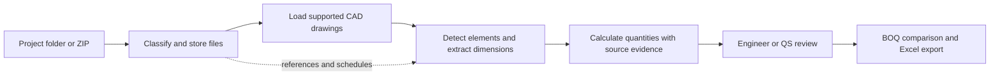

<div align="center">

# QTO & BOQ Automation

### A local-first CAD quantity takeoff workspace for civil engineering teams

Turn drawing folders into structured, reviewable quantity takeoffs and BOQ outputs. Keep source drawings, assumptions and review decisions connected to the quantities they support.

[](https://github.com/Asad-saeed7293/static-group-qto/actions/workflows/django.yml)


[Features](#what-you-can-do) · [Workflow](#takeoff-workflow) · [Supported-files](#supported-files) · [Install](#quick-start-on-windows) · [Limits](#measurement-scope-and-review)

</div>

---

## Built for drawing-led quantity takeoff

QTO & BOQ Automation helps civil engineers, quantity surveyors and estimators move from CAD drawings to quantities they can inspect, check and prepare for BOQ review. It brings project files, drawing analysis, calculation evidence and review controls into one workspace.

### What you can do

| Workflow area | What it does |
|---|---|
| **Project folder intake** | Upload a complete folder or ZIP. The app classifies supported files as drawings, schedules, specifications, client BOQs or references, then makes them available in the project workflow. |
| **CAD drawing analysis** | Read DXF geometry, layers, blocks, text and drawing units. DWG measurement is available when ODA File Converter is installed on the machine running the app. |
| **Civil and structural takeoff** | Calculate supported quantities for foundations, columns, walls, beams, slabs, blockwork, plaster, lintels, earthworks, waterproofing, manholes, tanks and boundary walls. |
| **Traceable quantities** | Review source drawing, layer, entity and calculation details alongside detected elements and quantities. Missing inputs and assumptions can be surfaced for engineering review. |
| **Project rules and review** | Configure measurement rules, resolve missing project inputs, inspect candidate quantities and retain review decisions and audit history. |
| **BOQ preparation** | Generate detailed BOQ lines, compare an imported client BOQ, review variances and export Excel reports. A reference workbook template can be used when configured. |
| **Drawing and model review** | Browse drawings and inspect a generated 3D structural view with floor and element filters, fit-to-view, zoom, orbit and pan controls. |
| **Project monitoring** | Track processing stages, BOQ readiness, open review items, changes between runs and project reports. |
| **Project assistant** | Ask questions about stored project records and get answers with source references. The assistant does not measure drawings or create quantities. |

## Takeoff workflow



The workflow is drawing-led: processing requires supported CAD drawings. Other uploaded documents are retained as references or inputs according to their type; they are not all measured automatically.

## Supported files

| Project input | Supported formats | How the app uses them |
|---|---|---|
| Drawings | `.dxf`, `.dwg` | DXF is read directly. DWG measurement requires ODA File Converter installed on the server. |
| Schedules | `.dxf`, `.pdf`, `.xlsx` | Stored and used where supported by the schedule extraction workflow. |
| Specifications | `.pdf`, `.docx` | Stored with the project as reference documents; their text is not automatically converted into measured quantities. |
| Client BOQ | `.xlsx`, `.csv` | Imported for comparison on the Client BOQ workflow. |
| Project archive | `.zip` | Extracted and classified during intake. |

Scanned drawings and images are not automatically measured. Unsupported files can be kept as project references where the intake workflow allows.

## Measurement scope and review

- The quantity engine works from supported drawing geometry and recorded project inputs; it does not claim to measure quantities from scanned images.
- The 3D view visualizes supported takeoff elements and inferred placements. It is not a coordinated BIM model or a design-authoring model.
- Results depend on drawing content, units, configured measurement rules and confirmed inputs. Review flagged quantities, assumptions and rules before using outputs in a tender, contract or construction issue.
- Keep client drawings, BOQs, credentials and other confidential information in local storage. The `data/` directory contains runtime project records and must not be committed to a public repository.

## Quick start on Windows

### Requirements

- Windows 10 or newer
- Python 3.10 or newer, available on `PATH`
- Internet access on first launch so the launcher can install Python packages
- ODA File Converter installed on the host if DWG measurement is needed

### Start the app

1. Download or clone this repository.
2. Run `run.bat`. On first launch it creates a local `.venv`, installs `requirements.txt` and starts the FastAPI server.
3. Open <http://127.0.0.1:8765> in your browser.
4. Create or select a project, upload a project folder or add files by category, review the classified intake, then process the drawings.

Keep the launcher window open while using the app; closing it stops the server. The default server binds to `127.0.0.1` on port `8765`.

### Start from a terminal

```powershell
python -m pip install -r requirements.txt
python -m uvicorn server.app:app --host 127.0.0.1 --port 8765
```

The project also provides `npm run dev` as a Windows launcher shortcut; Node.js is not required when starting with `run.bat` or the Python command above.

## Command-line workflows

The CLI supports processing, recalculation, export, benchmarking, daily reporting and project questions:

```powershell
python qto_cli.py run --project my-project
python qto_cli.py recalc --project my-project
python qto_cli.py export --project my-project --out samples
python qto_cli.py daily-report
python qto_cli.py ask "Which projects have BOQ issues?" --project my-project
```

Replace `my-project` with a project identifier already available to the local app. Use `python qto_cli.py --help` to see available commands and options.

## Repository map

| Path | Responsibility |
|---|---|
| `server/app.py` | FastAPI routes, project workflows, file intake and exports |
| `qto/ingest`, `qto/extract` | CAD loading, geometry extraction and schedule reading |
| `qto/elements`, `qto/calc`, `qto/takeoff` | Element detection and quantity calculations |
| `qto/boq`, `qto/export` | BOQ generation, comparison and report exports |
| `qto/knowledge`, `qto/review` | Measurement rules, project references and review controls |
| `qto/viewer3d.py`, `web/model3d.js` | 3D model data and interactive viewer |
| `web/` | Browser interface; no separate front-end build step |
| `config/` | Application settings, rules and BOQ configuration |
| `data/` | Local project files, runs, caches, decisions and audit records |

## Development checks

Install dependencies and run the test suite with:

```powershell
python -m pip install -r requirements.txt
python -m pytest -q
```

GitHub Actions runs the test suite on Python 3.11 and 3.12 for pushes and pull requests targeting `main`.

---

<p align="center">
  <sub>Designed for reviewable construction takeoff workflows. Quantities and BOQs require qualified engineering review before issue.</sub>
</p>
